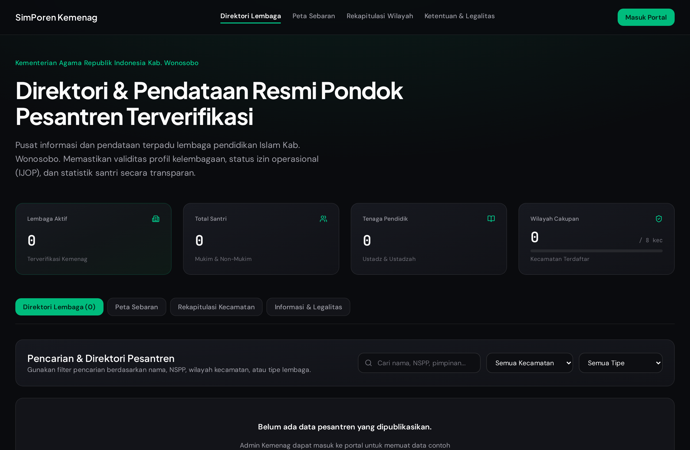
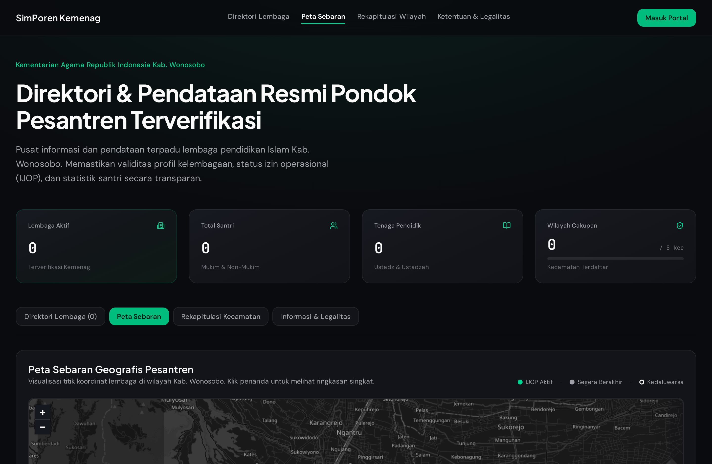
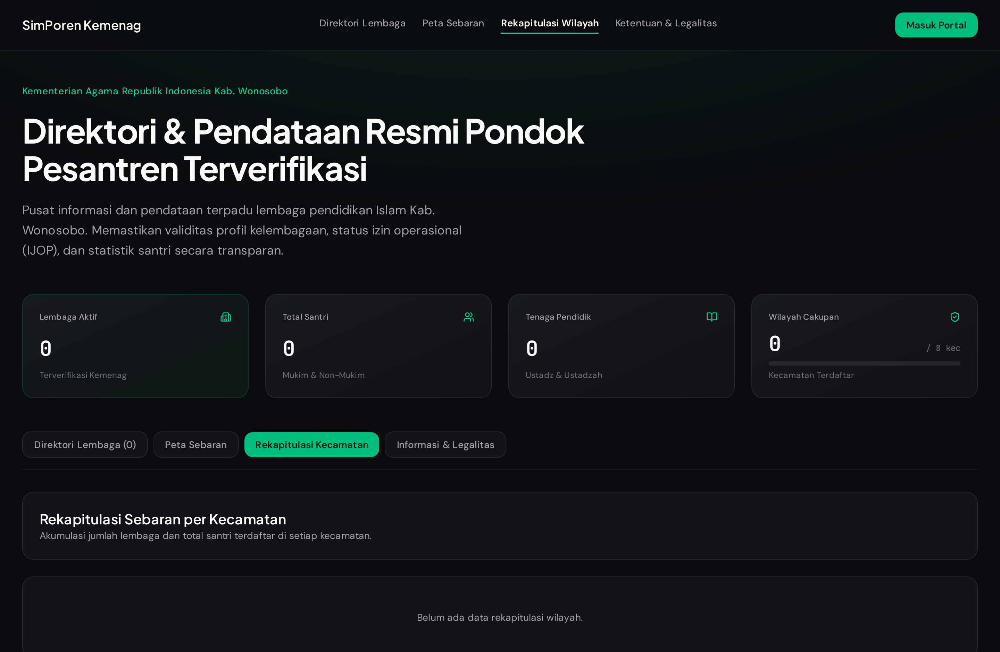
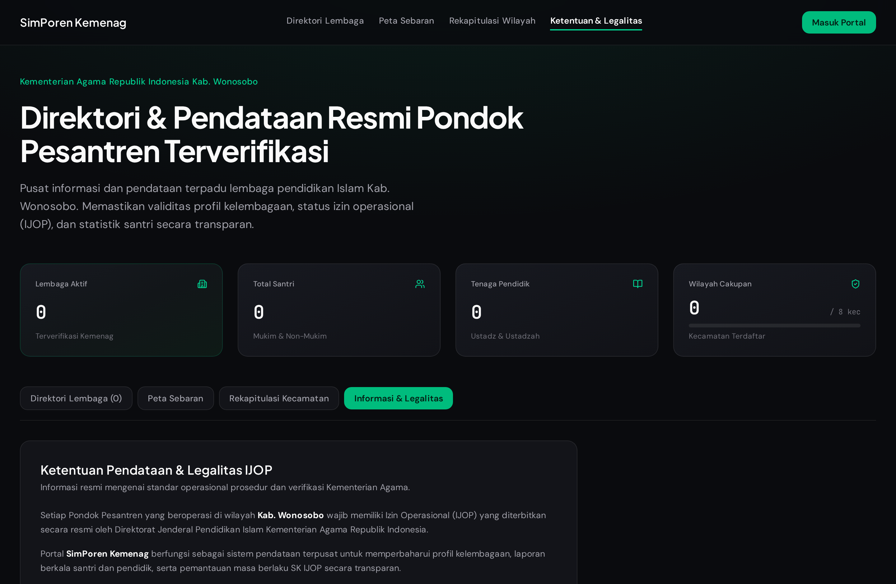
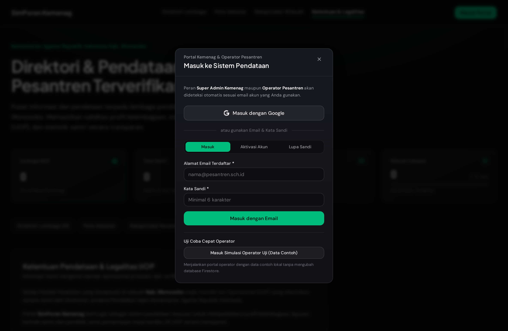
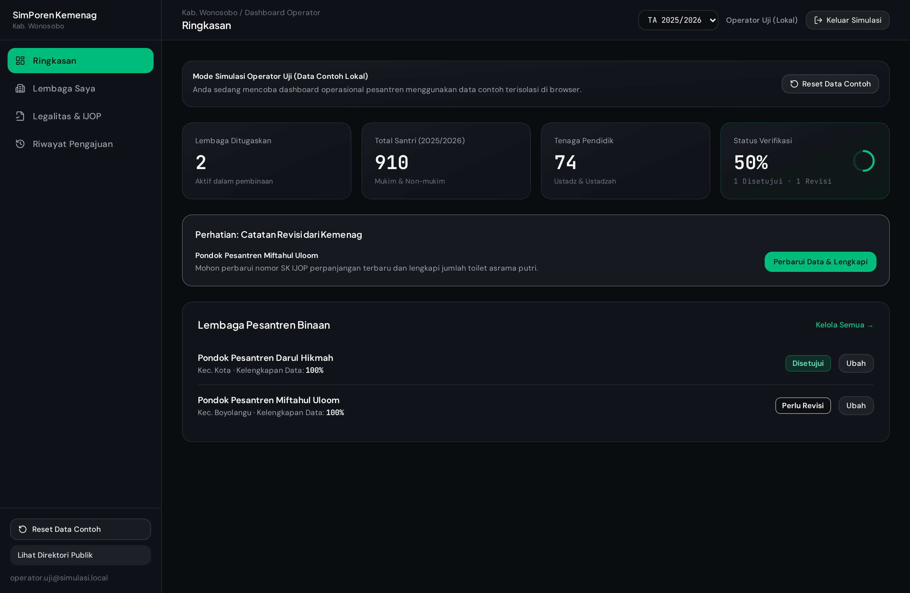
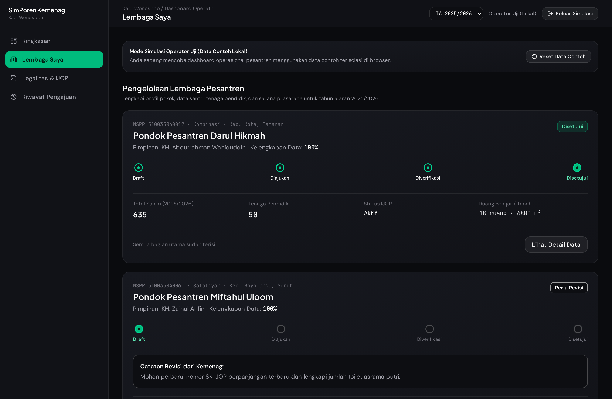
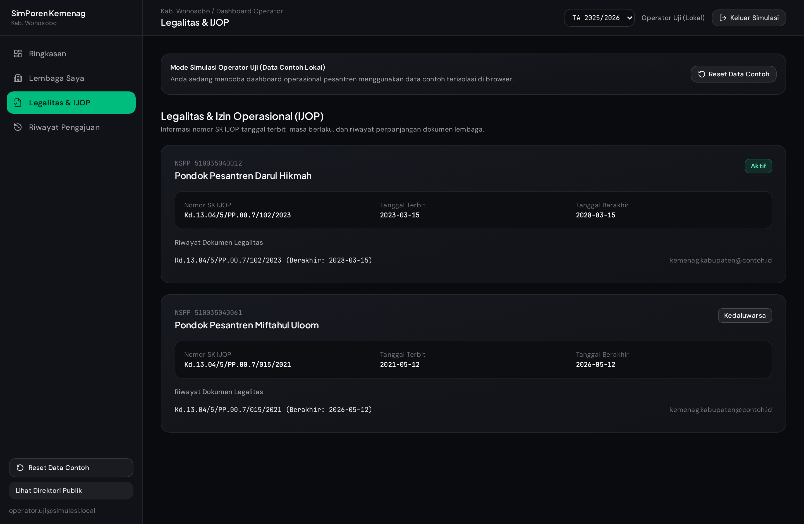
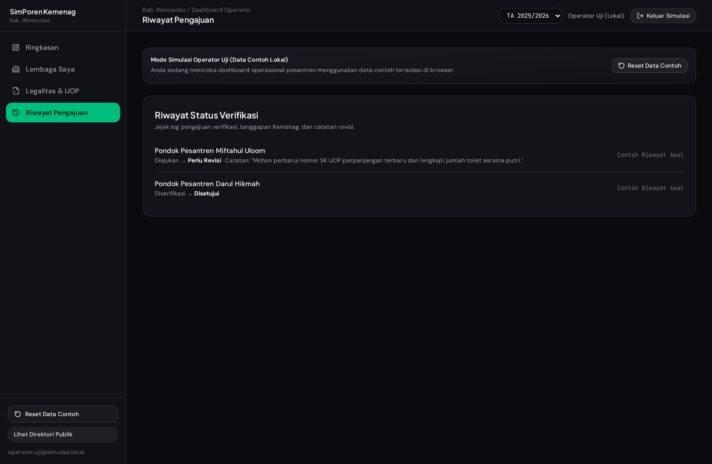
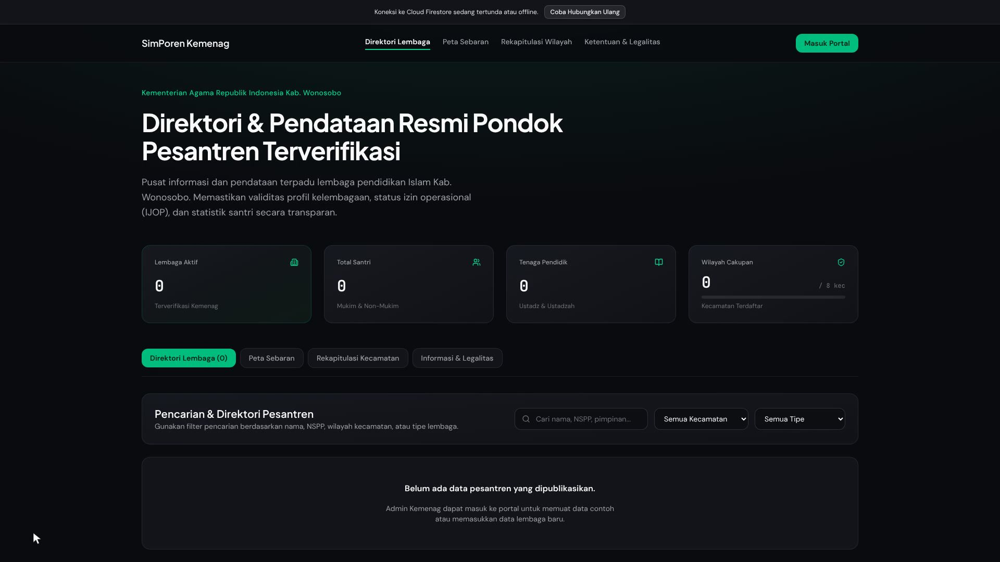

# SimPoren Kemenag

**Sistem Pendataan Pondok Pesantren Terverifikasi — Kementerian Agama Republik Indonesia Kabupaten Wonosobo.**

SimPoren adalah aplikasi web untuk mengelola profil lembaga pesantren, legalitas IJOP, data santri dan pendidik, serta alur verifikasi berjenjang antara **Operator Pesantren** dan **Super Admin Kemenag**. Data yang sudah disetujui otomatis dipublikasikan ke direktori publik.

Dibangun dengan React 19 + TypeScript + Vite dan Firebase (Authentication + Cloud Firestore), serta dapat dipasang sebagai PWA.

---

## Tampilan

### Direktori Publik (tanpa login)

| Direktori & Statistik | Peta Sebaran |
| --- | --- |
|  |  |

| Rekapitulasi Kecamatan | Ketentuan & Legalitas |
| --- | --- |
|  |  |

### Masuk Portal



Portal mendeteksi peran secara otomatis dari email yang digunakan. Tersedia pula **Masuk Simulasi Operator Uji** dengan data contoh lokal untuk mencoba aplikasi tanpa menyentuh database Firestore.

### Dashboard Operator (mode simulasi, data contoh)

| Ringkasan | Lembaga Saya |
| --- | --- |
|  |  |

| Legalitas & IJOP | Riwayat Pengajuan |
| --- | --- |
|  |  |

---

## Fitur Utama

### 1. Direktori Publik
- Empat tab: **Direktori Lembaga**, **Peta Sebaran**, **Rekapitulasi Wilayah**, **Ketentuan & Legalitas**.
- Ringkasan statistik: jumlah lembaga aktif, total santri, tenaga pendidik, dan cakupan kecamatan.
- Pencarian berdasarkan nama, NSPP, desa, atau nama pimpinan; filter kecamatan dan tipe pesantren.
- Peta interaktif (Leaflet) dengan warna penanda sesuai status IJOP.
- Detail lembaga dalam dialog native.
- Dapat dinonaktifkan sementara melalui `system_config.publicDirectoryEnabled`.

### 2. Portal Super Admin
| Menu | Fungsi |
| --- | --- |
| Dashboard | Ringkasan kondisi pendataan dan status verifikasi |
| Data Pesantren | Tambah/ubah profil pokok, legalitas, dan data periodik |
| Verifikasi | Mengajukan, memverifikasi, menyetujui, atau menolak pengajuan |
| Legalitas & IJOP | Mengelola nomor SK, tanggal terbit/berakhir, dan riwayat perubahan |
| Operator & Akses | Mengundang operator, menugaskan pesantren, mengaktifkan/menonaktifkan, mencabut akses |
| Laporan | Ekspor data ke Excel dan PDF (dengan sanitasi formula spreadsheet) |
| Audit Log | Jejak seluruh aksi pengguna |
| Pengaturan | Nama kabupaten, periode aktif, multi-operator, multi-pesantren, edit pasca-persetujuan, direktori publik |

### 3. Portal Operator
- **Ringkasan**, **Lembaga Saya**, **Legalitas & IJOP**, **Riwayat Pengajuan**.
- Hanya dapat mengakses pesantren yang ditugaskan kepadanya.
- Dapat mengubah data berstatus *Draft* atau *Perlu Revisi*, lalu mengajukannya kembali.

---

## Alur Verifikasi

```
   Operator                              Super Admin Kemenag
  ─────────                              ───────────────────
  isi data  →  Draft
              │  ajukan
              ▼
           Diajukan ──── verifikasi ───► Diverifikasi
                                            │
                                 ┌──────────┴──────────┐
                              setujui               tolak (+ catatan revisi)
                                  ▼                     ▼
                              Disetujui             Perlu Revisi
                                  │                     │
                     publish ke direktori          kembali ke Draft
                     publik (`public_pesantren`)
```

- Status: `draft` · `diajukan` · `diverifikasi` · `disetujui` · `ditolak` (ditampilkan sebagai *Perlu Revisi*).
- Saat **disetujui** dan lembaga berstatus aktif, data otomatis disalin ke koleksi `public_pesantren` dan muncul di direktori publik. Saat dikembalikan ke draft/ditolak, data publik dihapus.
- Setiap perubahan status dicatat atomik di `verifikasi_logs` dan `audit_logs` menggunakan `writeBatch`.
- Aturan transisi ada di `src/lib/domain.ts` (`canTransitionVerification`). Penolakan wajib disertai catatan revisi.

### Status IJOP
Dihitung otomatis dari tanggal berakhir: **Aktif**, **Segera Berakhir** (≤ 90 hari), **Kedaluwarsa**, atau **Belum Ada**.

### Kelengkapan Data
Persentase kelengkapan dihitung dari lima bagian: Profil Pokok, Legalitas/IJOP, Data Santri, Tenaga Pendidik, dan Sarana & Prasarana.

---

## Teknologi

- **Frontend:** React 19, TypeScript, Vite 8, Tailwind CSS 4, Motion, Lucide Icons
- **Backend/Layanan:** Firebase Authentication (Google & email/password + verifikasi email), Cloud Firestore (realtime `onSnapshot` + fallback REST), Firebase Storage
- **Peta:** Leaflet
- **Ekspor:** `write-excel-file`, `jspdf` + `jspdf-autotable`
- **PWA:** `vite-plugin-pwa` (instalabel, indikator offline)
- **Runtime:** Node.js ≥ 22.18, Bun 1.x (lockfile `bun.lock`)

---

## Struktur Proyek

```
src/
├── App.tsx                     # Auth gate, routing antar workspace, data publik
├── firebase.ts                 # Inisialisasi Firebase & helper error
├── types.ts                    # Tipe data & konstanta (batas blueprint, kecamatan)
├── components/
│   ├── PublicDirectory.tsx     # Halaman publik (4 tab)
│   ├── LoginModal.tsx          # Login, aktivasi, reset sandi, mode simulasi
│   ├── AuthWorkspace.tsx       # Dashboard Super Admin / Operator
│   ├── OperatorSandboxWorkspace.tsx  # Simulasi operator dengan data lokal
│   ├── PesantrenFormModal.tsx  # Form profil, legalitas, data periodik
│   ├── PesantrenMap.tsx        # Peta Leaflet
│   └── ...
└── lib/
    ├── domain.ts               # Aturan transisi, status IJOP, kelengkapan, sanitasi
    ├── firestoreService.ts     # Batch write & transaksiFirestore
    ├── firestoreRest.ts        # Fallback baca data publik via REST
    ├── export.ts               # Ekspor Excel/PDF
    ├── seedData.ts             # Data contoh pesantren
    └── ...
```

Koleksi Firestore: `users`, `admins`, `operator_invites`, `operator_assignments`, `pesantren`, `public_pesantren`, `legalitas`, `legalitas_history`, `data_periodik`, `verifikasi_logs`, `audit_logs`, `system_config`. Aturan keamanan ada di `firestore.rules`.

---

## Menjalankan Secara Lokal

```bash
# instal dependensi
bun install          # atau npm install

# salin konfigurasi lingkungan (opsional)
cp .env.example .env

# jalankan server pengembangan
bun run dev          # http://localhost:3000

# build produksi
bun run build
bun run preview

# pemeriksaan tipe
bun run lint
```

> **Catatan:** direktori publik akan kosong sampai ada data di koleksi `public_pesantren` (data muncul setelah verifikasi persetujuan oleh Super Admin). Untuk mencoba antarmuka tanpa Firebase, gunakan **Masuk Portal → Masuk Simulasi Operator Uji (Data Contoh)**.

### Konfigurasi Firebase

Proyek Firebase yang dipakai tercantum di `firebase-applet-config.json` (`projectId`, `appId`, `apiKey`, dll). Sebelum produksi:

1. Aktifkan **Authentication** dengan penyedia *Google* dan/atau *Email/Password*.
2. Terapkan `firestore.rules` dan buat indeks sesuai kebutuhan kueri.
3. Buat dokumen `system_config/default`.
4. Tetapkan email bootstrap super admin di `BOOTSTRAP_ADMIN_EMAIL` (`src/types.ts`) — default: `wafaesey@gmail.com`.

---

## Demo Video

Video demo direkam otomatis dengan skill `video-demo` dari **build produksi yang di-pin**, memakai narasi lokal (Kokoro) tanpa layanan cloud. Semua data yang tampil berasal dari data contoh — tidak ada akun atau alamat nyata yang direkam.

### Menjawab permintaan revisi (Operator)

[](https://wafa-coder.github.io/simporen-kemenag/demo/)

**[▶ Putar video di browser (GitHub Pages)](https://wafa-coder.github.io/simporen-kemenag/demo/)**

Atau unduh langsung: [`operator-review.mp4`](docs/demo/operator-review.mp4) · [`full-tour.mp4`](docs/demo/full-tour.mp4)

Durasi ±27 detik · 1080p (H.264/yuv420p + AAC) · narasi bahasa Inggris · data contoh lokal.

> GitHub tidak menyediakan pemutar untuk MP4 di halaman file repository, jadi video diputar lewat halaman GitHub Pages di atas.

> Alur yang ditampilkan: membuka portal → masuk simulasi operator → membaca catatan revisi di dashboard → membuka formulir lembaga → menuju bagian Legalitas/IJOP.

---

## Lisensi & Kredit

Dibuat untuk Kementerian Agama Republik Indonesia Kabupaten Wonosobo. Seluruh data contoh bersifat fiktif dan tidak berisi data pribadi nyata.
